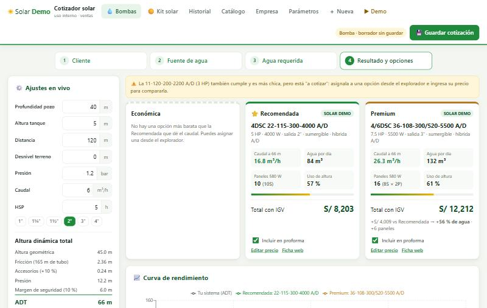
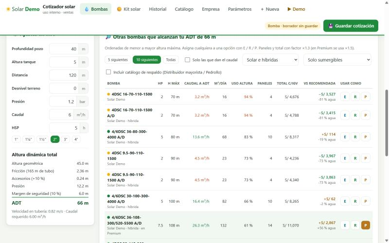
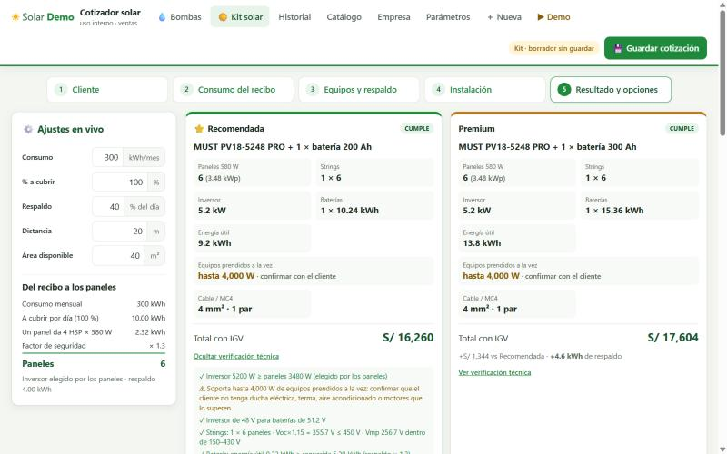
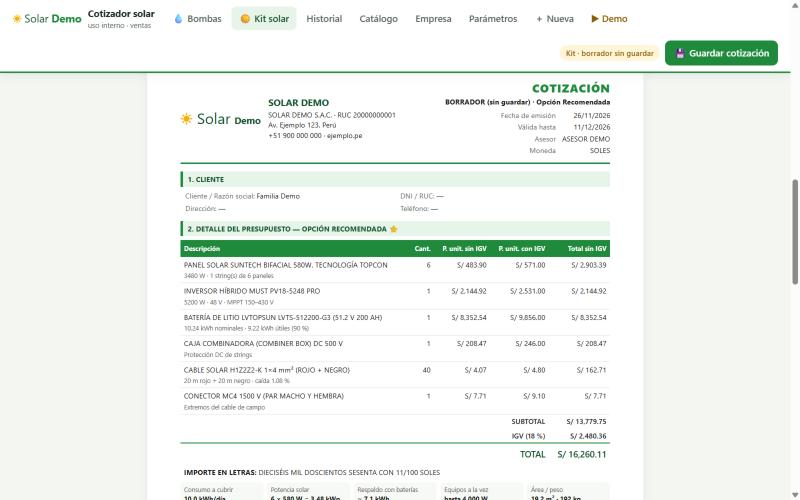

# ☀️ Cotizador solar — bombas solares y kits fotovoltaicos

Aplicación web para que el equipo de ventas de una empresa de energía solar en el Perú cotice en minutos:

- **Sistemas de bombeo solar** para pozos, canales y reservorios.
- **Kits solares para casas**: paneles, inversor, baterías y protecciones.

Reemplaza una calculadora en Excel que se llenaba a mano. Calcula la ingeniería, propone 2 o 3 opciones (Económica, ⭐ Recomendada, Premium) y genera la **proforma en PDF** y el **mensaje de WhatsApp** para el cliente.

> 🔗 **Demo en vivo (limitada):** https://tatoo24.github.io/cotizador-solar/
> Los datos de esta versión (empresa, cuentas bancarias y precios) son **de demostración**. El código fuente es privado.

## Qué resuelve

| Antes (Excel) | Ahora |
|---|---|
| Se copiaban datos a mano a la proforma | Proforma PDF automática, con importe en letras e IGV |
| La bomba se elegía solo por altura | Se calcula el caudal real de cada bomba a la altura del cliente |
| Sin inclinación, presión ni pérdidas reales | Hazen-Williams sobre toda la tubería, desnivel, presión de goteo/aspersión y margen de seguridad |
| Una sola opción | Económica, Recomendada y Premium, más un explorador para comparar |
| Kits solares hechos "a ojo" | Dimensionamiento completo: strings, MPPT, Voc en frío, baterías por energía y corriente, cable por caída de tensión |

## Funcionalidades

**Bombas solares**
- Asistente de 4 pasos: cliente, fuente de agua, agua requerida y resultado.
- Altura dinámica total (ADT): altura geométrica + fricción (Hazen-Williams, C=150) + accesorios + presión + margen.
- Curva de cada bomba calibrada con su punto óptimo publicado: `H = Hmax·(1 − (Q/Qmax)ⁿ)`.
- Selección por **menor costo por m³ útil al día**, con catálogo de respaldo si el principal no cubre.
- Explorador de las 5, 10 o todas las bombas que alcanzan la ADT, con diferencia de precio y de agua. Con un clic se asignan a una opción.
- Gráfico de curvas con el punto de trabajo (Recharts).

**Kits solares para casa**
- Del recibo de luz (kWh/mes) a los paneles: `⌈kWh·1000/30 / (4 HSP·580 W) × 1.3⌉`.
- Inversor: potencia frente a paneles y carga, voltaje de batería y armado de strings dentro de Voc×1.15, rango MPPT, corriente y potencia por MPPT. Si hace falta, inversores en paralelo.
- Baterías LiFePO4: energía útil (DoD 90 %) y corriente de descarga y de carga.
- Cable de 4 o 6 mm² según caída de tensión, combiner box de 500 o 1000 V y conectores MC4.
- Modo rápido "por paneles": indica cuántos watts de equipos soporta el sistema a la vez.
- Verificación técnica ✓/⚠ por cada condición.

**General**
- Proforma PDF (página resumen + una por opción) y mensaje de WhatsApp.
- Historial con guardado manual, numeración correlativa (BS-/KS-), búsqueda, exportar e importar.
- Pantallas de **Empresa**, **Parámetros** (todas las constantes de las fórmulas) y **Catálogo** editables, sin tocar código.
- Demo guiada automática con subtítulos y voz.
- Diseño responsive y uso offline (sin backend).

## Tecnología

- **React 18 + TypeScript + Vite**, sin backend. Los datos están en JSON y lo que edita el usuario se guarda en `localStorage`.
- **Recharts** para las curvas de las bombas.
- **Vitest**: 33 tests del motor de cálculo, incluido un caso real resuelto a mano que la app reproduce al céntimo (S/ 14,519.97).
- Impresión a PDF con CSS `@media print`.

**Arquitectura:**
- Motor de cálculo en funciones puras y testeadas: hidráulica, curvas y selección de bombas; dimensionamiento de kits solares.
- Interfaz por asistentes, resultados con explorador, proforma imprimible y pantallas de ajustes.
- Catálogo y parámetros en JSON, editables desde la propia app.

## Sobre esta demo y el código

- La **demo en línea es limitada**: muestra todo el flujo de cotización, pero las proformas llevan marca de agua "DEMO – NO VÁLIDA" y no se puede guardar, enviar por WhatsApp ni cambiar los ajustes.
- El **código fuente es privado**: este repositorio solo contiene la vitrina y la demo compilada. Si quieres revisar el código, por ejemplo en un proceso de selección, escríbeme y te doy acceso.
- **© 2026 Tatoo24. Todos los derechos reservados.** Ver [LICENSE](LICENSE).

## Autor

Desarrollado por [@Tatoo24](https://github.com/Tatoo24).
